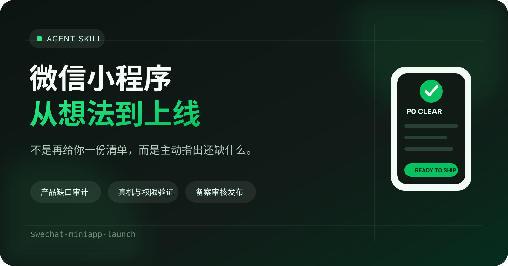

<div align="center">
  

  <h1>微信小程序从想法到上线，一次把缺口找齐</h1>

  <p><strong>不是又一份流程清单。它会先读你的项目，主动指出还缺什么。</strong></p>

  <p>
    <a href="README_EN.md">English</a> ·
    <a href="SKILL.md">Skill 入口</a> ·
    <a href="references/gap-audit.md">缺口审计规则</a> ·
    <a href="references/pitfalls.md">踩坑库</a>
  </p>

  <p>
    
    
    
  </p>
</div>

---

很多人不是不会写小程序，而是会在第 17 次追问 Agent 时才发现：主体选错了、Demo 没复刻、AppID 还是测试号、隐私声明与代码不一致、真机壁纸被裁切，或者上传成功却根本还没有发布。

`wechat-miniapp-launch` 把这些分散知识变成一个主动工作的 Skill：它会读取已有对话、代码、配置、截图与平台进度，维护项目账本，并在你提交审核之前指出真正缺少的内容。

## 它与普通教程有什么不同

| 普通教程 | 这个 Skill |
|---|---|
| 从头给一份长清单 | 先识别你已经完成了什么 |
| 等你发现问题再问 | 主动扫描缺口与冲突 |
| “代码能跑”就算完成 | 区分源码、构建、真机、体验版与线上证据 |
| 产品、技术、审核混在一起 | 分阶段设门槛，逐项验收 |
| 每次重新解释背景 | 持续维护 `known / verified / missing / blocked / later` 项目账本 |
| 泛泛而谈 | 给出准确后台路径、可复制文案和验收条件 |

## 它会主动检查什么

- **产品**：目标用户、核心任务、V1 边界、变现方式、成功指标与高风险表述。
- **设计**：批准的 Demo 是否被完整复刻，字体、背景、色块、比例和状态是否丢失。
- **逻辑**：个性化是不是假的，算法来源、缺省值、联网数据、缓存和失败策略是否完整。
- **工程**：构建目录、`miniprogramRoot`、基础库兼容、包体积、旧 AppID 和调试配置。
- **真机**：小屏滚动、安全区、权限拒绝、持久化、相册成品、离线与错误状态。
- **主体**：个人、个体户或企业是否适合类目、支付与后续商业化。
- **合规**：服务类目、隐私指引、采集声明、接口权限、备案和审核文案是否一致。
- **发布**：上传、体验版、审核、通过、发布和线上冒烟测试是否被错误地混为一谈。

## 输出不是一堵文字墙

```text
阶段：正式 AppID 真机验证
已验证：1.0.0 已上传，核心页面可访问

P0 缺口
- 隐私声明选择“未采集”，但代码保存出生日期
  影响：审核声明与实际行为冲突
  下一步：改为采集，并注明仅本机存储
  验收：隐私指引、代码和审核备注三者一致

P1 风险
- 壁纸只在模拟器看过，尚未检查手机相册成品

接下来三步
1. 修正隐私声明
2. 从体验版保存并检查壁纸
3. 提交备案与审核
```

## 安装

### Codex

```bash
git clone https://github.com/windieicloudie/wechat-miniapp-launch-skill.git \
  ~/.codex/skills/wechat-miniapp-launch
```

重新开启会话后即可自动发现，也可以明确调用：

```text
使用 $wechat-miniapp-launch 检查我的微信小程序还缺什么，并带我完成上线。
```

也可以把本仓库作为 Agent Skill 导入任何支持 `SKILL.md` 的兼容工具。不同工具的安装目录可能不同，请以对应产品说明为准。

## 最适合这样使用

```text
我有一个微信小程序想法，请先审计产品和上架风险，再帮我做 V1。
```

```text
这是现有项目，请不要从头问我。读取代码并告诉我离提交审核还缺什么。
```

```text
开发者工具已经上传成功。请按实际状态继续带我备案、提审和发布。
```

```text
审核被拒了。这是原始驳回信息，请定位原因、修复并做回归检查。
```

## 真实踩坑沉淀

这个 Skill 来源于一个真实小程序从视觉 Demo 到 1.0.0 提审的全过程，已经覆盖：

- Demo 获批后实现却擅自变样；
- 模拟器能看，手机上需要多滑一下才能点到底部按钮；
- 可选链语法导致微信预览失败；
- 个性化资料保存了，推荐结果却没有变化；
- 定位接口没有权限导致上传失败；
- 壁纸预览正常，保存到相册后被放大裁切；
- 项目仍绑定旧主体 AppID；
- 本地保存个人资料，却误选“未采集用户隐私”；
- 把“上传成功”误认为“已经上线”。

详细预防规则见 [踩坑库](references/pitfalls.md)。

## 仓库结构

```text
.
├── SKILL.md                         # 技能入口与阶段门槛
├── agents/openai.yaml              # Skill UI 元数据
├── references/
│   ├── gap-audit.md                # 主动缺口审计与项目账本
│   ├── product-development.md       # 产品、设计、开发与真机测试
│   ├── registration-review.md       # 注册、隐私、备案、审核与发布
│   └── pitfalls.md                  # 真实失败模式与预防
└── assets/hero.svg                 # 项目封面
```

## 设计原则

1. **先检查，后提问**：能从代码、配置和截图获得的信息，不再让用户重复回答。
2. **只问改变结果的问题**：架构、资质、成本或不可逆操作之外的问题尽量批量处理。
3. **证据优先**：代码存在不等于已验证；真机、体验版和线上环境分别验收。
4. **最小权限**：不需要定位就不请求定位，不读取相册就只声明写入。
5. **动态规则要核实**：类目、资质、费用和支付能力必须以微信官方实时规则为准。
6. **不隐藏真实业务**：若产品属于受监管服务，应选择正确类目并准备资质，而不是换一套模糊文案。

## 贡献

欢迎提交真实的审核驳回、设备兼容、权限、构建和发布案例。请去除 AppSecret、身份证、手机号、邮箱、OpenID 等敏感信息，并描述：复现条件、原始错误、根因、修复和验证方式。

## License

[MIT](LICENSE)
